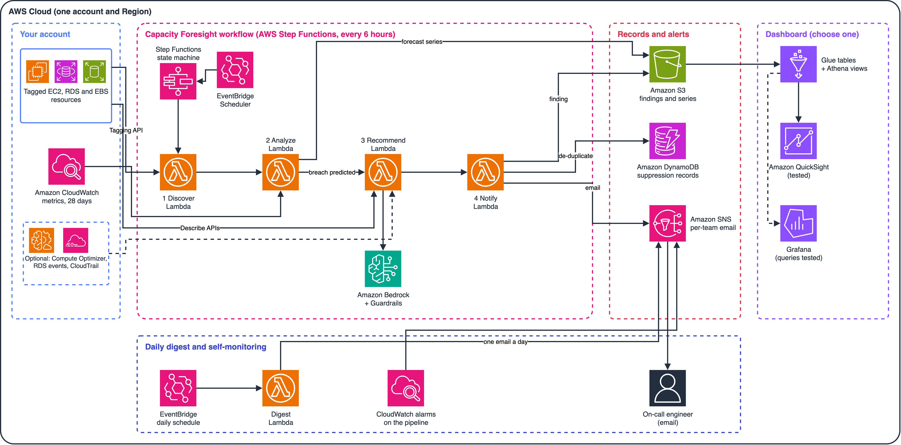

# Predict Capacity Breaches Before They Happen with Amazon Bedrock

Capacity Foresight predicts which of your Amazon EC2 instances, Amazon RDS databases and Amazon EBS volumes will cross a capacity threshold in the coming hours or days. For each predicted breach, Amazon Bedrock writes a remediation plan grounded in the resource's real configuration, and the on-call engineer gets one email.

It is a reference sample. It is read-only: it never changes your resources.

> This is sample code for demonstration and learning. It is not production-ready. Review and test it against your own security, compliance and operational requirements before any production use.



The diagram is also available as an editable draw.io file: [`docs/architecture.drawio`](docs/architecture.drawio).

## What it does

1. **Discovers** resources by tag (`capacity-foresight=monitor`).
2. **Forecasts** each metric from CloudWatch. Hourly data is reduced to daily peaks (maximum for "above" metrics, minimum for "below" metrics such as free storage). The trend removes the weekly pattern, ignores data before a resize or failover, and is projected over the metric's horizon. The result is the *runway*: hours until the threshold is crossed, with an earliest and latest estimate.
3. **Recommends** with Amazon Bedrock. The model receives the numeric evidence, the resource's configuration (instance class, allocated storage, whether storage autoscaling is on, Auto Scaling group limits, pending modifications) and any optional AWS signals you enable. It returns a ranked plan through a forced tool call.
4. **Notifies** by email through Amazon SNS, once per finding. A worse urgency re-notifies, and so does a recurrence after the metric was healthy again. Alerts carry message attributes so each team can subscribe to its own. An optional daily digest summarizes the rest.
5. **Alarms** on its own health: failed runs, AWS Lambda errors, AI falling back to a plain notice, and a missing run.
6. **Visualizes** with Amazon QuickSight over Amazon Athena (optional).

```
Amazon EventBridge Scheduler
        |
        v
AWS Step Functions
  Discover (tag API) --> Map: each resource
                           Analyze (CloudWatch, trend) --> Map: each finding
                                                             Recommend (Bedrock) --> Notify (SNS email)
                                                               |  |                      |
                                       resource facts <--------+  +--> cache         Amazon DynamoDB (de-dupe)
                                     optional AWS signals                           (+ daily digest, alarms)
  Analyze + Notify write JSON lines --> Amazon S3 --> AWS Glue tables --> Athena views --> QuickSight
```

## Deploy

**Prerequisites:** See [`docs/PREREQUISITES.md`](docs/PREREQUISITES.md) for detailed setup (Bedrock model access, CloudWatch metrics, resource tagging, QuickSight).


```bash
export AWS_REGION=us-east-1
export NOTIFICATION_EMAIL=you@example.com
export ARTIFACTS_BUCKET=my-existing-bucket-in-this-region
./scripts/deploy.sh
```

To choose models, set the profile (or model) ID and the base model behind it. Set both, because IAM is scoped to exactly these. Any other parameter goes in `EXTRA_PARAMETER_OVERRIDES`:

```bash
export BEDROCK_MODEL_ID=<profile or model ID>
export BEDROCK_FOUNDATION_MODEL_ID=<base model ID>
export EXTRA_PARAMETER_OVERRIDES="RoutingTagKey=Team EnableDigest=true"   # optional
./scripts/deploy.sh
```

Prefer the SAM CLI? The template is a SAM template: `sam build && sam deploy --guided --capabilities CAPABILITY_IAM CAPABILITY_AUTO_EXPAND`, then run `./scripts/create_views.sh`.

Confirm the SNS subscription email, then try the demo (it also works with no real resources tagged):

```bash
./scripts/run_demo.sh
```

The demo runs the full workflow against three synthetic resources (no real resources are touched). It calls Bedrock and sends two real emails. Run it again and no duplicate emails are sent.

## Configure

Everything below is a stack parameter unless noted. Optional features are off or empty by default where they need extra permissions or data sharing.

| Area | Parameter | Default | Notes |
|---|---|---|---|
| Models | `BedrockModelId`, `BedrockFoundationModelId` | Claude Sonnet 5.5 profile | Used for MEDIUM and LOW findings, and for CRITICAL/HIGH unless a high-risk model is set. |
| | `BedrockHighRiskModelId` + `BedrockHighRiskFoundationModelId` | empty | Optional larger model for CRITICAL and HIGH findings. |
| | `BedrockFallbackModelId` + `BedrockFallbackFoundationModelId` | empty | Tried when the chosen model fails or returns invalid output, for example after a model is retired. |
| | `CreateGuardrail` / `GuardrailId` / `GuardrailVersion` | `true` | Creates a guardrail with the prompt-attack filter. Set `false` to bring your own or none. |
| | `RecommendationCacheHours` | `12` | Reuse a plan for an unchanged finding instead of calling the model each run. `0` turns it off. |
| Scope | `DiscoveryTagKey` / `DiscoveryTagValue` | `capacity-foresight` / `monitor` | Which resources are monitored. |
| | `ContextTagKeys` | `Name` | Only these tag keys are shown to the model. |
| | `RoutingTagKey` | empty | Tag whose value becomes the SNS message attribute `route`. |
| | `MaxResources` | `500` | Per-run safety cap. |
| Optional AWS signals | `EnableRdsEvents` | `true` | Last 7 days of RDS events for the instance. |
| | `EnableComputeOptimizer` | `false` | Compute Optimizer rightsizing findings. Requires opt-in. |
| | `EnableCloudTrailChanges` | `false` | Names and times of recent write API calls (never identities). |
| Alerting | `ScheduleExpression` | `rate(6 hours)` | |
| | `SuppressionDays` | `7` | An unchanged finding is emailed at most once in this period. When the metric reads healthy again (and the alert is at least 24 hours old) the record is cleared, so a recurrence alerts again even inside the period. |
| | `MinImmediateUrgency` | `LOW` | Findings below this appear only in the digest and dashboard. |
| | `EnableDigest` / `DigestSchedule` | `false` / daily 13:00 UTC | One summary email a day listing open findings, each tagged with its team. |
| | `DigestPerRoute` | `false` | `true` sends one digest per route with a `route` attribute, for teams that subscribe with a filter policy. |
| | `EnableAlarms` / `MissingRunAlarmHours` | `true` / `12` | See "Alarms" below. |

Thresholds, directions, horizons, minimum history and fit options (`weekly_seasonality`, `detect_level_shift`, `min_r2`, `interval_z`, `lookback_days`) live in [`src/config/thresholds.json`](src/config/thresholds.json). Redeploy to apply.

### Routing alerts to teams

Set `RoutingTagKey` (for example `Team`). Each alert is published with message attributes `route`, `urgency`, `resource_type` and `kind` (`alert` or `digest`). A team subscribes its own address with a filter policy:

```bash
aws sns subscribe --topic-arn <NotificationTopicArn> --protocol email --notification-endpoint orders@example.com \
  --attributes '{"FilterPolicy": "{\"route\": [\"orders-team\"]}"}'
```

The stack's own subscription (`NotificationEmail`) receives everything. A resource without the tag has no `route` attribute, so only unfiltered subscriptions see it.

### Alarms

When `EnableAlarms` is `true`, CloudWatch alarms publish to the same topic for: a failed workflow execution, any Lambda error, the AI falling back to the plain notice (custom metric `CapacityForesight/RecommendationFallback`), and no workflow run within `MissingRunAlarmHours`. A guardrail block (usually a resource tag containing instruction-like text) is not an outage: it publishes the separate metric `CapacityForesight/GuardrailIntervention` and the alert says why the plan is missing. The missing-run alarm treats no data as a breach, so expect it right after deployment until the first run completes.

## Tune before you trust it

Replay the forecast on a saved export or live data. Nothing is emailed:

```bash
python scripts/replay.py --file cpu.csv --resource-type EC2 --metric CPUUtilization
python scripts/replay.py --live --resource-id i-0123456789abcdef0 --resource-type EC2 --metric CPUUtilization --threshold 70
```

Check the recommendation quality once, with the model you chose. This makes a few Bedrock calls:

```bash
python scripts/run_eval.py --model-id <model or profile ID> --runs 2
```

Read the output file under `evals/results/`; the automatic checks are heuristics. Repeat after changing the prompt or the model.

## Dashboard

The pipeline writes findings and forecasts to S3 and exposes them through three Athena views (`v_latest_findings`, `v_latest_series`, `v_finding_history`). A dashboard only reads those views, so you can use the tool you already have. `deploy.sh` creates the views.

| Option | How | Status |
|---|---|---|
| **Amazon QuickSight** | `python scripts/setup_quicksight.py --stack-name <stack>` then `python scripts/create_dashboard.py --stack-name <stack>` | Tested end to end: all three sheets render with live data |
| **Grafana** (Amazon Managed Grafana or your own) | [`docs/GRAFANA.md`](docs/GRAFANA.md): data source settings and the SQL for each panel | The queries were run against Athena; the Grafana UI itself was not tested |
| Anything that queries Athena | Point it at the three views | Not tested |

QuickSight needs a subscription in the account first (see [`docs/PREREQUISITES.md`](docs/PREREQUISITES.md)). The setup script creates a least-privilege IAM role scoped to this stack's bucket, workgroup and database, and hands it to the data source directly (`AthenaParameters.RoleArn`), so QuickSight's account-wide access to your S3 buckets does not need to be configured. The dashboard script builds three sheets: a risk board, a trend and forecast chart with a resource selector, and a recommendations sheet. Manual steps are in [`quicksight/DASHBOARD_GUIDE.md`](quicksight/DASHBOARD_GUIDE.md).

See [`docs/ARCHITECTURE.md`](docs/ARCHITECTURE.md) for the architecture and where this fits next to CloudWatch, AWS DevOps Agent and CloudWatch Omni.

## Security design

Controls built in:

- **Least-privilege IAM, one role per function.** Describe and metric-read actions that have no resource type (EC2, Auto Scaling, CloudWatch, Resource Groups Tagging, CloudTrail, Compute Optimizer) use `*`; RDS describe actions are scoped to this account and Region. Everything else is scoped to this stack's bucket prefixes, table, topic, key and functions. Bedrock access is limited to the exact models and profiles you configure. Permissions for optional signals exist only when you enable them.
- **Read-only against your resources.** No function can modify EC2, RDS or EBS. Remediation is a human decision.
- **Data at rest and in transit.** S3 is encrypted, versioned, blocks public access, logs access to a separate bucket, and denies non-TLS and pre-TLS 1.2 requests. The SNS topic and the de-duplication table use customer managed keys with rotation, and the table has point-in-time recovery. All function and workflow log groups are encrypted with a customer managed key. Step Functions logging excludes execution data.
- **Prompt injection.** Tags and AWS-supplied text are untrusted. Only keys in `ContextTagKeys` reach the model, values are sanitized and truncated, `<` and `>` are escaped, the Guardrail prompt-attack filter evaluates the untrusted block, and the system prompt marks it as data.
- **Model output is untrusted.** It must pass schema validation (fixed action types, bounded sizes), URLs are stripped, urgency cannot be lowered below what the runway implies, and nothing it returns is executed.
- **CloudTrail signals are minimal.** Only API names and times of write calls are read. Identities, source addresses and request parameters are not.
- **Bounded runtime.** The workflow and every task have timeouts, model calls stay inside the Lambda's time budget, and Athena queries are capped at 10 GiB scanned.
- **No secrets.** There are no credentials, API keys or hard-coded endpoints anywhere in the code.

Accepted trade-offs and what to add if your policy requires it:

| Not included | Why | If you need it |
|---|---|---|
| Lambda in a VPC | Functions call only AWS APIs and hold no private data | Add `VpcConfig` and VPC endpoints for the services used |
| Customer managed AWS KMS key on the S3 buckets | Buckets use S3-managed encryption; the stored data is derived metrics and advice | Set `SSEAlgorithm: aws:kms` and a key on the buckets |
| S3 Object Lock | It would block the retention rules and make clean-up impossible for data that is regenerated and expires | Enable it on a bucket you create yourself |
| Dead-letter queues, reserved concurrency | Invocations are synchronous from Step Functions, which retries and bounds concurrency | Add per-function concurrency limits |

Know before you deploy:

- Anyone who can tag a resource `capacity-foresight=monitor` adds it to scope, which can add Bedrock calls. `MaxResources`, workflow concurrency and the recommendation cache bound the cost. Add an AWS Budgets alert on Bedrock spend and consider a tag policy on that tag key.
- Anyone allowed `states:StartExecution` on the workflow can start a demo run. It touches no real resources, but it sends emails and writes demo rows to the dashboard data.
- Alert emails travel over SNS email and contain account ID, resource IDs and the model's advice. Use filter policies so people see only their own alerts.
- The Lambda roles include the AWS managed `AWSLambdaBasicExecutionRole`, which allows log writes anywhere. Each function also has an explicit Deny for every log group except its own, so the effective permission is its own log group only.
- A cached recommendation can be up to `RecommendationCacheHours` old. The email always shows current numbers; only the AI wording can lag.

## Cost

The workflow runs a few Lambda invocations per tagged resource per run, one Bedrock call per finding that is not served from the cache, and small S3 (including versioning and access logs), Athena, DynamoDB (including point-in-time recovery) and KMS usage. The Bedrock call dominates and scales with the number of findings, not the number of resources. A high-risk model costs more per call, so use it only for CRITICAL and HIGH if you set one. Check current pricing for [Bedrock](https://aws.amazon.com/bedrock/pricing/), [Lambda](https://aws.amazon.com/lambda/pricing/) and [Step Functions](https://aws.amazon.com/step-functions/pricing/). QuickSight is billed per user and is optional.


## Where AI is used, and where it is not

| Concern | Approach | Why |
|---|---|---|
| Trend, runway range, confidence | Deterministic least squares in code | Numbers must be reproducible and explainable. |
| Minimum urgency | Derived from the earliest runway (24/48/96 hour bands, configurable) | The model may raise urgency but can never lower it. |
| Probable cause, ranked actions, sizing, risk, cost direction, verification steps | **Amazon Bedrock** | Depends on engine, storage type, Auto Scaling limits, Multi-AZ, recent changes. A fixed action catalog cannot cover that. |
| Model output | Tool-use JSON validated against an allow-list of action types, bounded lengths, links removed | Free text from a model is never executed or trusted blindly. |
| Untrusted input | Tags are allow-listed and sanitized, `<` `>` escaped, passed as delimited data and (by default) through a Guardrail prompt-attack filter | Mitigates prompt injection through tags and AWS-supplied text. |
| Model unavailable or retired | Optional fallback model, then a plain notice email | An outage in the AI layer must not silence alerts. |

## Limitations

- The trend is linear after removing the weekly pattern. It does not model monthly cycles, step growth after a launch, or one-off events. Findings with a poor fit (`r2` below `min_r2`) are suppressed.
- Level-shift detection needs a few days after the change. A very recent resize or failover is not yet recognized.
- Needs at least `min_points` (default 7) days of metric history to forecast. A resource already past its threshold is still reported.
- One account and Region per stack. Up to `MaxResources` (default 500, maximum 1000) per run.
- Model output is advice. Review it before acting.
- The template and logic are covered by unit tests and `cfn-lint`. Validate in a non-production account before wider use, including the Guardrail with tool use.

## Test

```bash
python3 -m venv .venv && . .venv/bin/activate
pip install -r requirements-dev.txt
PYTHONPATH=src:. pytest -q
cfn-lint template.yaml
bandit -q -r src scripts
```

## Clean up

```bash
./scripts/cleanup.sh
```

Both S3 buckets (data and access logs) are versioned and retained when the stack is deleted. The script empties them, including every object version and delete marker, and then deletes them.

Delete the QuickSight analysis and datasets you created manually.

## Layout

```
template.yaml            stack (SAM transform)
src/capacity_foresight/  forecast, recommender (Bedrock), enrichment, cache, facts, notifier, digest, storage helpers
src/handlers/            Lambda handlers: discover, analyze, recommend, notify, digest
src/config/thresholds.json
athena/views/            views read by QuickSight
quicksight/              dashboard guide
evals/                   golden cases for the one-time recommendation check
scripts/                 deploy, create_views, run_demo, cleanup, replay, run_eval, setup_quicksight, create_dashboard
tests/                   unit tests (no AWS calls)
docs/                    PREREQUISITES, ARCHITECTURE, GRAFANA
```

## Security

See [SECURITY.md](SECURITY.md) for the security policy, known considerations and how to report a vulnerability.

## License

This library is licensed under the MIT-0 License. See the [LICENSE](LICENSE) file.
