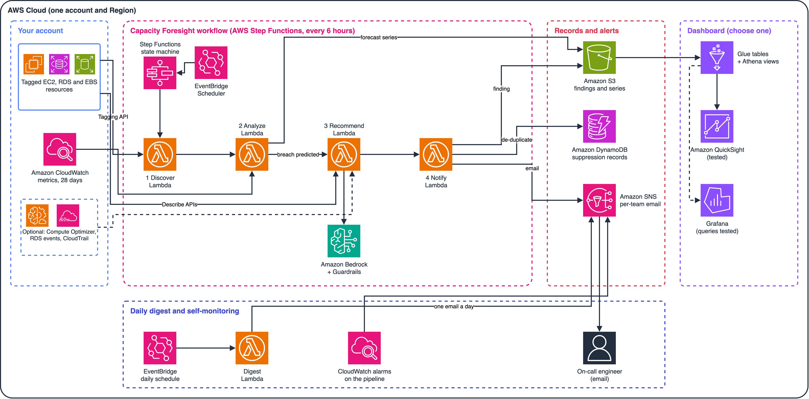
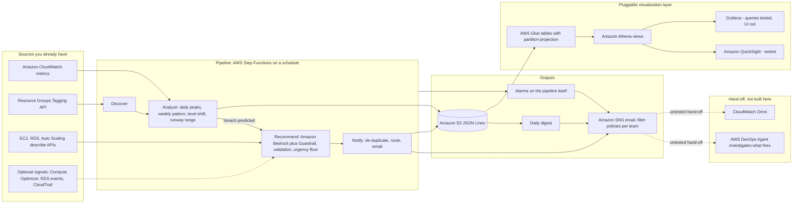

# Architecture

Capacity Foresight is a scheduled, read-only pipeline: find tagged resources, forecast each metric, ask a model what to do about the ones that will breach, tell the right people once, and record everything. The design separates what must be exact (the forecast) from what benefits from judgement (the plan), and keeps every optional piece independent.

## Overview

Editable source: [`architecture.drawio`](architecture.drawio) (open in draw.io or diagrams.net).

## Layers

## Design principles

1. **Numbers in code, judgement in the model.** The forecast is deterministic least squares, so it is reproducible and explainable. The model never produces the runway. It reads it and decides what to do.
2. **The model is an advisor behind guardrails.** Output is validated against a fixed set of action types, links are removed, and urgency cannot fall below what the runway implies. If no model works, a plain notice still goes out.
3. **Read-only.** No function can change a monitored resource.
4. **Optional means optional.** Each extra signal, the digest, the alarms, routing, the second model and the dashboard are separate switches. A minimal deployment is: discover, analyze, recommend, email.
5. **The data contract is the boundary.** Everything downstream of S3 reads three Athena views. That is why the dashboard can change without touching the pipeline.

## Where it sits among AWS operations tools

| Moment | Tool |
|---|---|
| Days before a threshold is crossed | **Capacity Foresight** (forecast, plan, email) or a hand-built `predict_linear` alarm in CloudWatch |
| A threshold has been crossed | CloudWatch alarms, CloudWatch Omni alerts |
| Investigating why | AWS DevOps Agent, CloudWatch investigations |
| Learning from repeated incidents | AWS DevOps Agent proactive prevention |
| Right-sizing for cost and fit | AWS Compute Optimizer (also an optional input here) |

Capacity Foresight publishes to Amazon SNS. CloudWatch Omni can notify an SNS topic from its own alerts, and AWS DevOps Agent can be started by alerts through its integrations and webhook, according to the AWS documentation and blogs. Whether an SNS message from this sample can start a DevOps Agent investigation has **not been built or tested**. Treat the dotted arrows in the diagram as a design intent, not a shipped feature.

## Deployment shape

One CloudFormation stack per account and Region, plus optional scripts for the dashboard:

| Component | Resources |
|---|---|
| Orchestration | One Step Functions state machine, five Lambda functions, one EventBridge schedule (and one for the digest) |
| Storage | One versioned S3 bucket (series and findings, lifecycle expiry) with server access logs in a second bucket; one DynamoDB table (de-duplication and cache with TTL) encrypted with a customer managed key, with point-in-time recovery |
| Analytics | Glue database and two tables with partition projection, an Athena workgroup with a scan limit, three views |
| Messaging | One SNS topic with a customer managed key (a second key protects the table and the log groups) |
| AI | One Bedrock Guardrail (optional), models by parameter |
| Operations | Four CloudWatch alarms, encrypted log groups with retention |
| Dashboard (optional) | `setup_quicksight.py` and `create_dashboard.py`, or the Grafana queries |

## Data flow and what leaves the account

| Data | Goes to |
|---|---|
| Hourly metric history | Stays in the account. Reduced to daily peaks in the Analyze function. |
| Trend statistics, resource configuration, allow-listed tag values, optional signals | Amazon Bedrock (and the Guardrail) in the account's Region or the inference profile's Regions |
| Alert text (account ID, resource IDs, plan) | SNS email subscribers |
| Findings and series | S3 in the account, read by Athena and the dashboard |

## What this design does not do

- Remediate. Advice only.
- Cover more than one account and Region per stack.
- Model monthly cycles or step growth after a launch.
- Replace an investigation tool. It tells you what is coming, not why something already broke.
